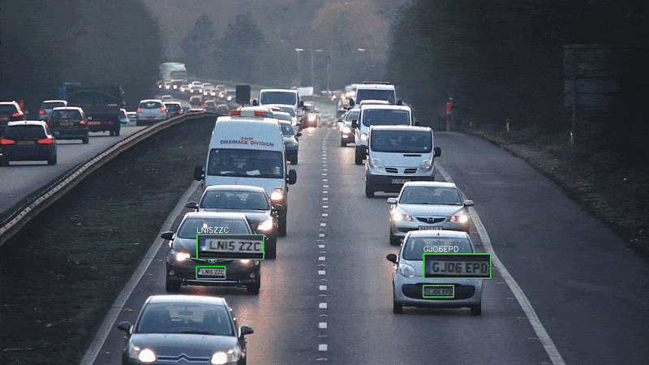

# License Plate Recognition with Stable OCR

A license plate detection and recognition system using YOLO11 and EasyOCR with advanced stability mechanisms to minimize text flickering in video streams.

## Demo

<table>
  <tr>
    <td align="center"><b>Example 1</b></td>
    <td align="center"><b>Example 2</b></td>
  </tr>
  <tr>
    <td></td>
    <td></td>
  </tr>
</table>


## Features

- **Real-time Detection**: Uses fine-tuned YOLO11 model for license plate detection
- **Stable OCR Output**: Advanced buffering system eliminates text flickering common in video OCR
- **Multi-frame Tracking**: Maintains consistent tracking across video frames using YOLO's tracking capabilities
- **Visual Overlay**: Real-time zoomed plate display with stable text overlay

## Core Innovation: Stable Pattern Recognition

The key innovation of this project is the **stable pattern recognition system** that addresses the common problem of flickering OCR results in video streams.

### The Problem
Traditional video OCR systems suffer from:
- Inconsistent text readings between frames
- Flickering display text that changes rapidly
- Poor user experience due to unstable output
- Lost accuracy due to single-frame processing

### Solution: Multi-Frame Stability Buffer

```python
def get_stable_pattern(track_id, new_text):
    if new_text and len(new_text.replace(" ", "")) >= 3:
        cleaned_text = new_text.strip().upper()
        
        if cleaned_text:
            plate_history[track_id].append(cleaned_text)
            
            # Count occurrences across frames
            text_counts = {}
            for text in plate_history[track_id]:
                text_counts[text] = text_counts.get(text, 0) + 1
            
            # Get most common text and its count
            most_common = max(text_counts, key=text_counts.get)
            max_count = text_counts[most_common]
            
            # Only update final result with high confidence
            if max_count >= 2:
                if track_id not in plate_final or max_count > plate_confidence[track_id]:
                    plate_final[track_id] = most_common
                    plate_confidence[track_id] = max_count
    
    return plate_final.get(track_id, "")
```

### How It Works

1. **Frame-by-Frame Collection**: Each OCR reading is stored in a rolling buffer (12 frames)
2. **Majority Voting**: The system counts occurrences of each text reading
3. **Confidence Thresholding**: Only displays text that appears in multiple frames (≥2 occurrences)
4. **Persistent Tracking**: Uses YOLO's tracking to maintain consistency across object movements
5. **Dynamic Updates**: Better readings replace previous ones only with higher confidence

### Benefits

- **Eliminates Flickering**: Text remains stable once detected (*May not be accurate)
- **Improved Accuracy**: Multiple readings increase confidence in results
- **Better UX**: Clean, professional-looking output suitable for production use
- **Flexible**: Works with various license plate formats without hardcoded patterns (*Might detect other information on the number plate)

## Project Structure

```
├── main.ipynb                              # Main OCR processing pipeline
├── license_plate_best.pt                  # Fine-tuned YOLO11 model (best weights)
├── Demo_Example_1.gif                     # Demo Example
├── Demo_Examole_2.gif                     # Demo Example
└── README.md                              # This file
```


## Usage

1. input your camera url into the main.py file
2. run the file python main.py

## Model Training

The model was found pretrained on Roboflow
model was fine-tuned using the Roboflow License Plate Recognition dataset:

1. **Dataset**: 7,057 training images, 2,048 validation images
2. **Model**: YOLO11n (Nano) for optimal speed/accuracy balance
3. **Training**: 5 epochs with AdamW optimizer
4. **Performance**: 96.2% mAP@50 on validation set


## Configuration

### Key Parameters

```python
CONF_THRES = 0.3          # YOLO confidence threshold
maxlen = 12               # Stability buffer size
min_confidence = 2        # Minimum occurrences for display
fx = fy = 3              # OCR preprocessing scale factor
```

### OCR Settings

```python
reader = easyocr.Reader(['en'], gpu=True)
allowlist = 'ABCDEFGHIJKLMNOPQRSTUVWXYZ1234567890'
```

## Technical Details

### Preprocessing Pipeline
1. **Color Conversion**: BGR → Grayscale
2. **Noise Reduction**: Gaussian blur (3×3 kernel)
3. **Binarization**: Adaptive thresholding
4. **Enhancement**: 3x bilinear upscaling
5. **OCR**: EasyOCR with alphanumeric allowlist

### Stability Mechanism
- **Rolling Buffer**: Stores last 12 OCR readings per tracked object
- **Majority Voting**: Selects most frequent reading
- **Confidence Scoring**: Tracks occurrence count
- **Dynamic Updates**: Higher confidence readings replace lower ones

## Acknowledgments

- [Ultralytics YOLO](https://github.com/ultralytics/ultralytics) for the detection framework
- [EasyOCR](https://github.com/JaidedAI/EasyOCR) for optical character recognition
- [Roboflow](https://roboflow.com/) for the license plate dataset
- OpenCV community for computer vision tools


## Future Enhancements
- [ ] A more edge compatible OCR like a small LPRnet
- [ ] Real-time processing optimization
- [ ] Database integration for plate logging
- [ ] Mobile deployment capabilities
- [ ] Advanced noise filtering algorithms